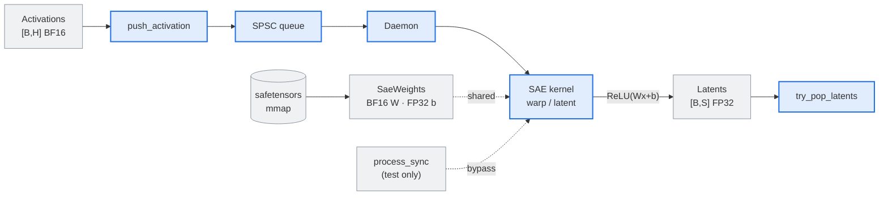

# Spire

Real-time SAE (sparse autoencoder) activation interception for GPU inference.

Spire sits beside a model's forward pass, takes residual-stream activations as
they are produced, and computes SAE latents on the GPU:

```
z = ReLU(W_enc · x + b_enc)
```

Activations can be handed to a background daemon through a bounded, lock-free
single-producer/single-consumer (SPSC) ring buffer. The same math is available
synchronously through the Python bindings for validation and benchmarking.

## Status

Spire is an early prototype.

- **Working:** the C++ library, memory-mapped safetensors loader, CUDA SAE
  encoder, C++ daemon, and both Python paths: `push_activation()` with
  `try_pop_latents()` for asynchronous processing, and the synchronous
  `process_sync()` path used by the parity test.
- **In progress:** callbacks, configurable queue sizes, and multi-GPU support.
- **Not implemented:** backpressure beyond the bounded queues. If the activation
  queue fills, `push_activation()` raises; if completed latents are not polled,
  the oldest results are dropped.

Verified in this workspace against PyTorch 2.15.0+cu132 on an NVIDIA GPU.

## Features

- **Lock-free handoff** — a bounded SPSC ring buffer (`ActivationQueue`) moves
  activation payloads between the producer and consumer with no mutexes and no
  payload copies during enqueueing.
- **Asynchronous results** — `try_pop_latents()` returns completed latents
  without blocking the producer. Input tensors are kept alive until the kernel
  finishes.
- **CUDA SAE encoder** — one warp computes one `(batch, latent)` dot product,
  with coalesced, 4x-unrolled `bfloat162` loads and a warp shuffle reduction.
- **Memory-mapped checkpoints** — `.safetensors` files are parsed in place
  (`mmap`), with support for BF16, F16, and F32 tensors. F16/F32 weights are
  converted to BF16 on the GPU; bias is kept in FP32.
- **RAII device memory** — `DeviceBuffer<T>` is a ref-counted `shared_ptr`
  handle, so payloads can share weight/bias allocations without copying.
- **PyTorch extension** — `spire_cpp` is built with scikit-build-core and
  installs as a normal module in your `uv` environment.

## Requirements

- CMake 3.30 or newer, Ninja, and a C++20/CUDA 20-capable compiler
- An NVIDIA GPU and the CUDA toolkit
- For Python bindings: Python 3.10+, PyTorch 2.0+, and an NVIDIA GPU
- Default build targets Blackwell (`sm_100` for B200, `sm_120` for RTX 50
  series). Use the `local` preset to compile for only the installed GPU.

## Building the C++ library

```bash
cmake --preset local
cmake --build --preset local
```

The main test harness runs a synthetic SAE encoder and checks every latent
against a host reference:

```bash
./build/local/spire
```

Run the C++ test suite with:

```bash
ctest --test-dir build/local --output-on-failure
```

Other presets: `default` (Blackwell `sm_100;sm_120`) and `debug`.

## Python bindings

The bindings are a compiled extension (`spire_cpp`) built with
scikit-build-core. They need an NVIDIA GPU, the CUDA toolkit, and PyTorch in the
target Python environment.

```bash
uv sync
uv run python -c "import spire_cpp; print(spire_cpp.__doc__)"
```

`uv sync` resolves the lockfile, installs PyTorch and the dev build tools, then
builds `spire_cpp` without build isolation (see
`no-build-isolation-package` in `pyproject.toml`). Building without isolation is
required so CMake can query the environment's own PyTorch for its include and
library paths.

Editable installs are configured with `editable.rebuild = true`, so changes to
the C++ sources are rebuilt incrementally the next time the module is imported.
No reinstall step is required.

If you prefer the low-level pip interface:

```bash
uv pip install torch scikit-build-core
uv pip install -e . --no-build-isolation
```

### Building a wheel

```bash
uv build --wheel --no-build-isolation
```

The resulting wheel contains `spire_cpp.so` at the root of `site-packages`.

## Usage

```python
import time

import torch
import spire_cpp

# Loads encoder.weight [sae_dim, hidden_dim] and encoder.bias [sae_dim]
# from the checkpoint and starts the background worker.
daemon = spire_cpp.SpireDaemon("/path/to/checkpoint.safetensors")

# Residual-stream activations: [batch_size, hidden_dim], BF16 on CUDA.
hidden_states = torch.randn(2, 4096, device="cuda", dtype=torch.bfloat16)

# Asynchronous handoff; returns after enqueueing.
daemon.push_activation(hidden_states)

# Poll for completed latents [batch_size, sae_dim] (FP32 on CUDA).
latents = None
for _ in range(500):
    latents = daemon.try_pop_latents()
    if latents is not None:
        break
    time.sleep(0.01)

if latents is None:
    raise RuntimeError("timed out waiting for asynchronous latents")

# TESTING ONLY: synchronous alternative that blocks until the result is ready.
sync_latents = daemon.process_sync(hidden_states)
```

`push_activation()` validates that the input is 2-D, contiguous, BF16, on the
same CUDA device as the weights, and has the same `hidden_dim` as the loaded
weights. The binding keeps the tensor alive until the daemon has consumed the
payload. It raises `RuntimeError` when the queue is full and releases the GIL
while enqueueing.

`try_pop_latents()` is non-blocking and returns `None` when no result is ready.
The completed-result buffer holds up to 1024 tensors; if it fills, the oldest
results are dropped.

`process_sync()` runs the encoder synchronously on the current stream and
returns the latents after synchronizing. It is intended for tests and reference
checks.

## Checkpoint format

Spire reads `.safetensors` files in place. The host must be little-endian, which
is checked at compile time. Tensor names and expected dimensions can be
customized in C++ with `SaeConfig`; the Python binding uses the defaults below.

| Tensor | Default name | Shape | Source dtypes | Device storage |
| --- | --- | --- | --- | --- |
| Encoder weights | `encoder.weight` | `[sae_dim, hidden_dim]` | BF16, F16, F32 | BF16, row-major |
| Encoder bias | `encoder.bias` | `[sae_dim]` | BF16, F16, F32 | FP32 |

Both tensors are required. Shapes are checked against `SaeConfig` when expected
dimensions are set.

## API

| Member | Description |
| --- | --- |
| `SpireDaemon(checkpoint_path)` | Loads encoder weights and bias, validates shapes, and starts the background worker. |
| `push_activation(hidden_states)` | Enqueues a validated CUDA tensor for asynchronous processing. Returns `None`. Raises `RuntimeError` if the queue is full. |
| `try_pop_latents()` | Returns the oldest completed latents tensor as `[batch_size, sae_dim]` FP32 on CUDA, or `None` if none are ready. |
| `process_sync(hidden_states)` | **Testing only.** Runs the encoder synchronously and returns latents `[batch_size, sae_dim]` as an FP32 CUDA tensor. |

## Architecture



Solid arrows are the asynchronous processing and result path; dashed arrows are
shared weight buffers and the test-only synchronous bypass.

| Component | Responsibility | Location |
| --- | --- | --- |
| `SafetensorsFile` / `MappedFile` | Read-only `mmap` of the checkpoint; validates the header and exposes raw tensor views. | `include/spire/SafetensorsFile.hpp`, `include/spire/mapped_file.hpp` |
| `load_safetensors` | Loads named encoder weight/bias tensors, checks shapes, and uploads them to the device. | `src/load_safetensors.cpp` |
| `SaeWeights` | Device-resident BF16 weights and FP32 bias; builds `ActivationPayload`s that share them. | `include/spire/SaeWeights.hpp` |
| `ActivationQueue` | Bounded lock-free SPSC queue between producer and daemon. | `include/spire/activation_queue.hpp` |
| `Daemon` | Background thread that pops payloads and launches the CUDA kernel. The Python binding adds completed-result polling. | `include/spire/daemon.hpp`, `src/daemon.cpp` |
| `launch_sae_kernel` | Warp-per-output BF16 SAE encoder. | `include/spire/kernels.cuh`, `src/kernels/sae_encoder.cu` |

## Project layout

```
include/spire/   Public C++ headers
src/             Host implementation, CLI harness, and Python bindings
src/kernels/     CUDA kernels
tests/           C++ tests and the Python numerical parity check
benchmarks/      Google Benchmark targets
```

## Tests

```bash
# C++ suite
ctest --test-dir build/local --output-on-failure

# End-to-end CUDA vs. PyTorch numerical parity (generates its own checkpoint)
uv run python tests/verify_parity.py

# Python end-to-end smoke test (expects spire_sae_weights.safetensors)
uv run python test_spire.py
```

`tests/verify_parity.py` writes a temporary safetensors checkpoint, loads it
through the binding, runs `process_sync`, and compares the result against
`torch.relu(x @ W.T + b)` within `atol=rtol=1e-2`.

`test_spire.py` pushes an activation through the asynchronous path, polls
`try_pop_latents()`, and compares the result against `process_sync()`. It loads
`spire_sae_weights.safetensors` from the working directory. That file is
gitignored, so generate or supply it first.

## Benchmarks

Google Benchmark targets cover the activation queue and are built by default:

```bash
cmake --build --preset local --target activation_queue_benchmark
./build/local/benchmarks/activation_queue_benchmark
```

Set `-DSPIRE_BUILD_BENCHMARKS=OFF` (or `-DSPIRE_BUILD_TESTS=OFF`) to skip them
when embedding Spire in another build.

## Troubleshooting

- **`BUILD_PYTHON_BINDINGS=ON but PyTorch was not found`** — the build backend
  cannot see PyTorch. Build without isolation (`uv sync` or
  `uv pip install -e . --no-build-isolation`) so CMake uses the environment's
  interpreter.
- **No CUDA device detected** — Spire requires an NVIDIA GPU and a driver that
  matches the CUDA toolkit.
- **`Activation queue is full`** — the consumer is not draining fast enough, or
  the background worker is not running. Increase the queue capacity in C++ or
  reduce the production rate.
- **`hidden_dim does not match` from `process_sync`** — the activation width and
  the checkpoint's `encoder.weight` columns disagree.
